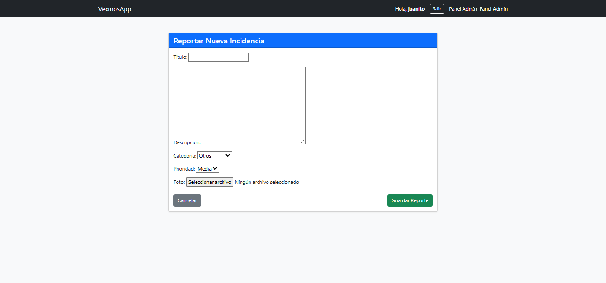
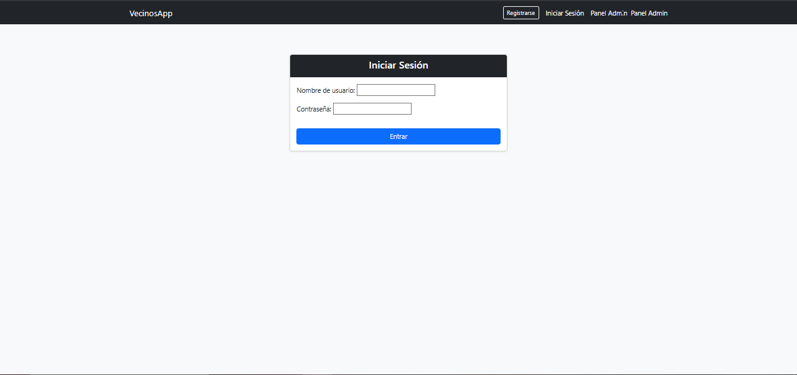
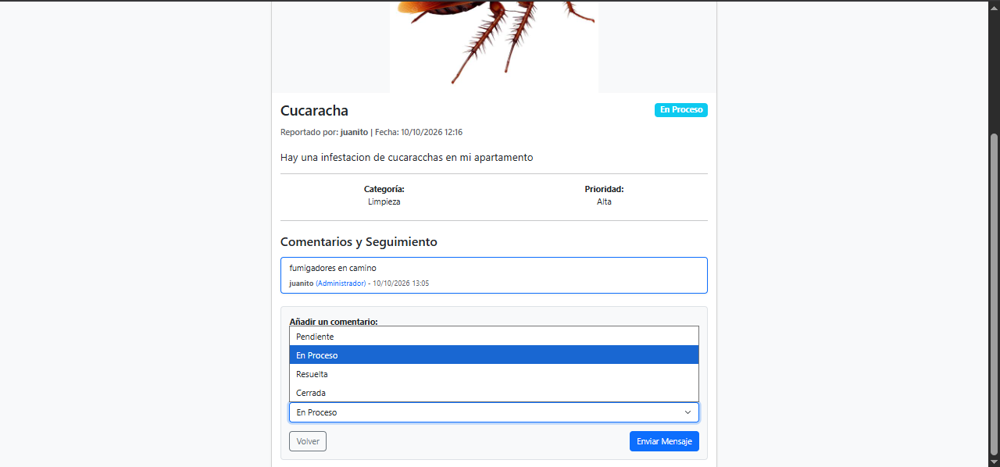
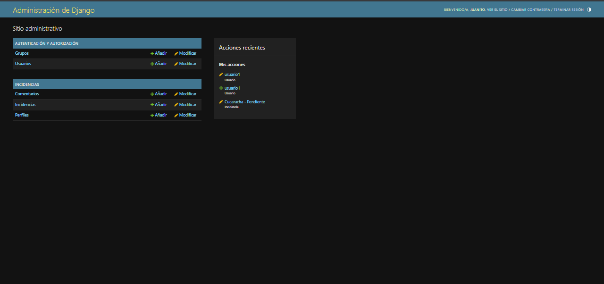
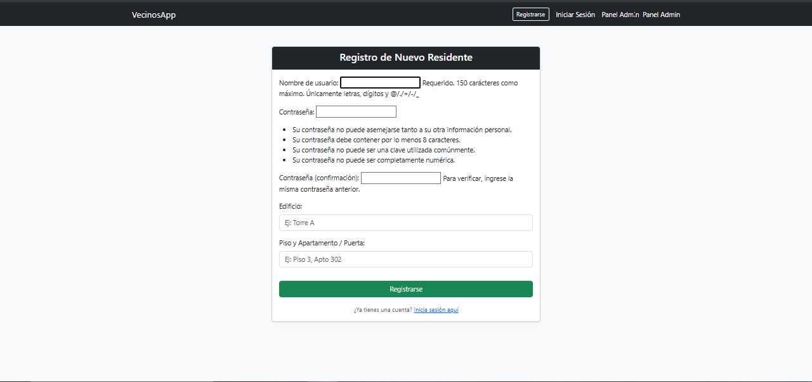
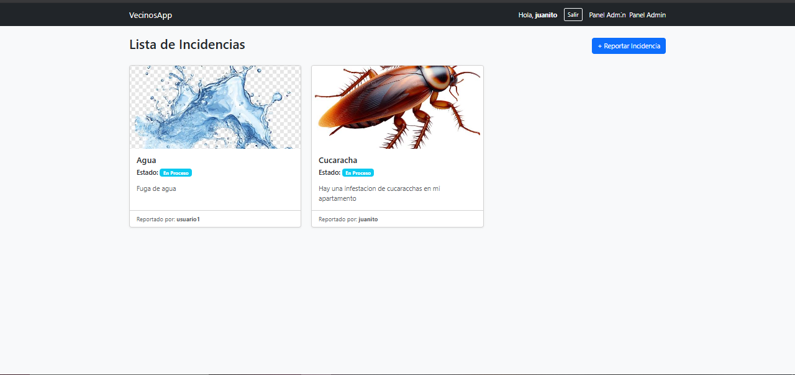

# VecinosApp - Sistema de Gestión de Edificios e Incidencias

Plataforma web desarrollada en **Django** para la administración de edificios, permitiendo a los residentes reportar incidencias (con soporte para archivos multimedia y categorización) y a los administradores gestionar su seguimiento mediante roles y comentarios.

---

## Tecnologías Utilizadas
* **Python** (v3.13+)
* **Django** (v5.0+)
* **Bootstrap 5** (Diseño frontend)
* **MySQL** (Base de datos relacional)
* **Pillow** (Gestión de imágenes)

---

## Guía de Instalación y Configuración

Para poner en marcha el proyecto localmente, primero debes clonar el repositorio en tu equipo con `git clone <url-de-tu-repositorio>` y entrar a la carpeta del proyecto (`cd gestion_edificios`). A continuación, crea y activa un entorno virtual ejecutando `python -m venv venv` seguido de `venv\Scripts\activate`. Una vez activo el entorno, instala las dependencias necesarias ejecutando `pip install django mysqlclient pillow` (o usando el archivo de requerimientos con `pip install -r requirements.txt`). Después, configura tu servidor MySQL creando una base de datos llamada `gestion_edificios` y verifica que tus credenciales coincidan en el archivo `vecinosapp/settings.py`. Procede a aplicar las migraciones ejecutando `python manage.py makemigrations` y `python manage.py migrate`. Para administrar el sistema con permisos totales, crea un superusuario ejecutando `python manage.py createsuperuser` y completando tus datos. Finalmente, arranca el servidor de desarrollo con `python manage.py runserver` y abre tu navegador web en la dirección `http://127.0.0.1:8000/`.

---

## Capturas de Pantalla de la Interfaz

1. **Forulario de Incidencias:** 
   
   
2. **Formulario de Registro / Login:** 
   
   
3. **Detalle y Comentarios:** 
   

4. **Panel de Admin:** 
   

5. **Formulario para registrarse:** 
   

6. **Incidencias:** 
   